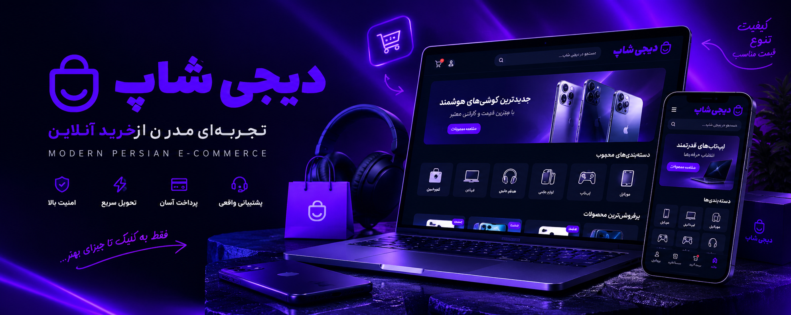
# DigiShop 🛍️

### A Modern Persian E-Commerce Experience

### [View live demo🚀](https://digi-shop-opal.vercel.app)

A modern, responsive e-commerce web application built with React, featuring a Persian RTL interface, elegant UI, and a smooth shopping experience.

<p align="center">
  
  
  
  
</p>

<p align="center">
  <b>Persian • RTL • Responsive • E-Commerce</b>
</p>

---

## ✨ Overview

**DigiShop** is a Persian e-commerce frontend project designed to deliver a clean, intuitive, and responsive online shopping experience.

Built with React and modern frontend tools, the project focuses on reusable UI components, responsive layouts, product discovery, and a user-friendly shopping interface.

## 🚀 Features

- 🛒 Product browsing and shopping cart interface
- 📱 Responsive design for desktop and mobile
- 🇮🇷 Persian language and RTL layout
- 🔍 Product search and category navigation
- 📦 Product detail pages
- 🔐 Login and user interface
- 💳 Checkout and payment flow UI
- 🎨 Custom styling and reusable components
- ⚡ Fast development and build workflow powered by Vite

## 🛠️ Tech Stack

| Technology | Purpose |
| --- | --- |
| React | UI development |
| Vite | Development server and build tool |
| JavaScript (ES6+) | Application logic |
| Tailwind CSS / CSS | Styling and responsive layouts |
| Swiper | Interactive sliders and carousels |
| React Router | Client-side navigation |

## 📸 Screenshots

<!-- Add screenshots of your application here -->

| Home Page | Product Listing |
| --- | --- |
| 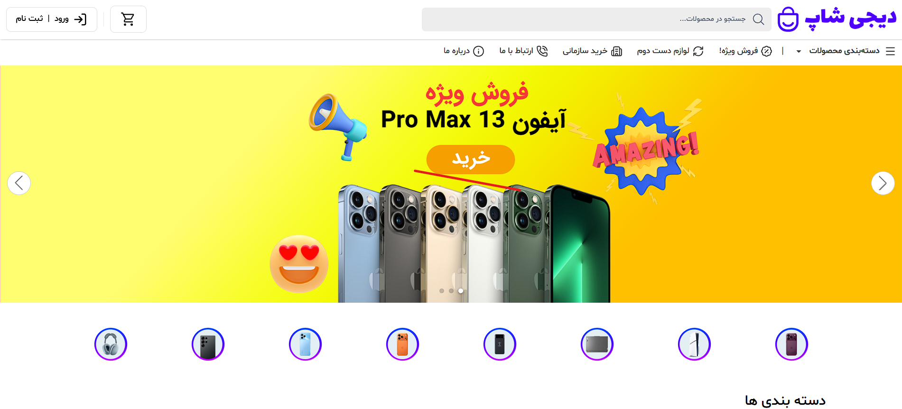 | 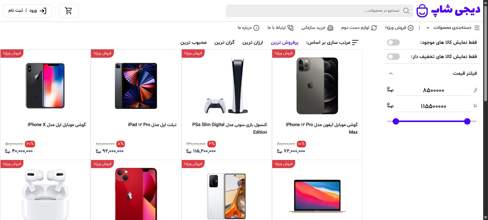 |

| Product Details | Cart |
| --- | --- |
| 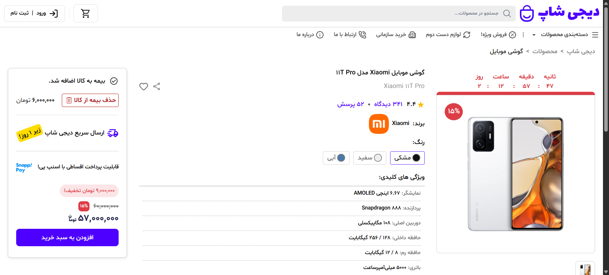 | 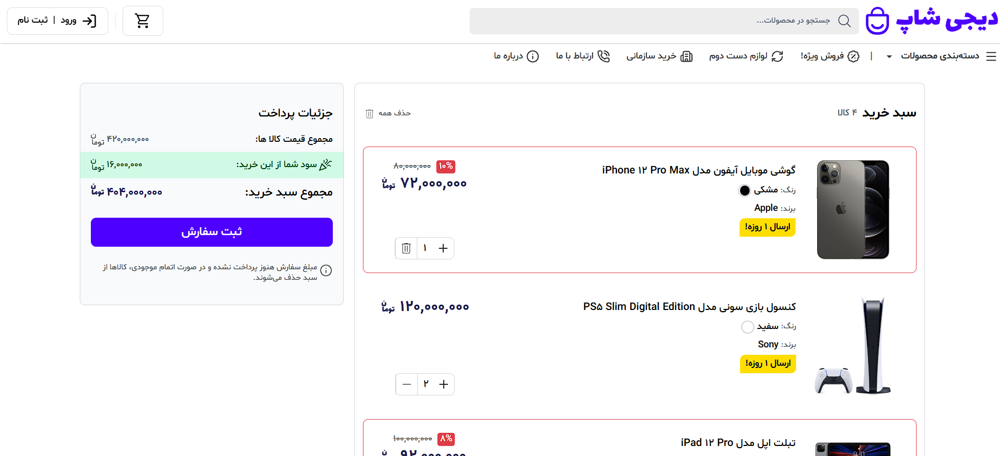 |

| Login | OTP Verification |
| --- | --- |
| 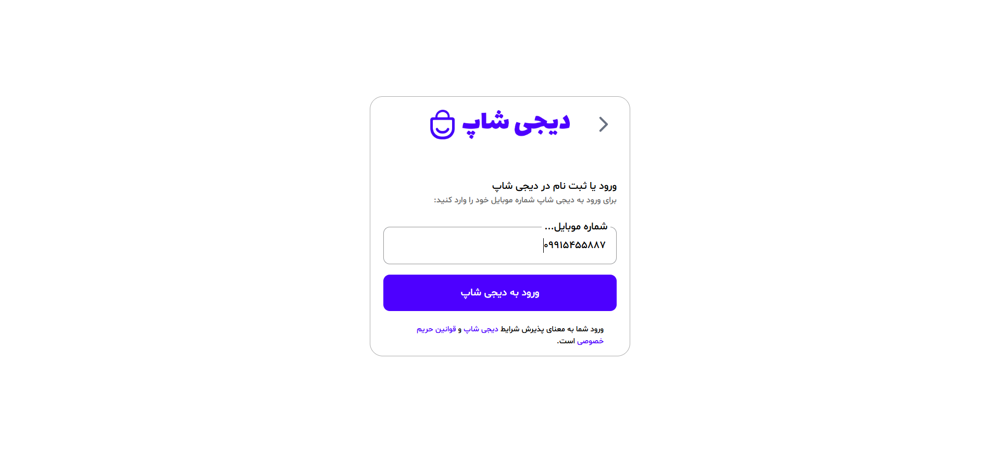 | 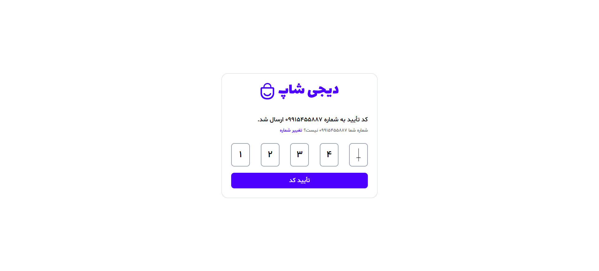 |

| Profile dashboard | Orders list |
| --- | --- |
| 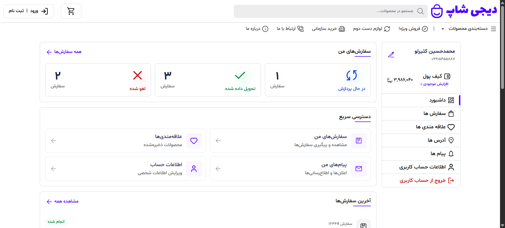 | 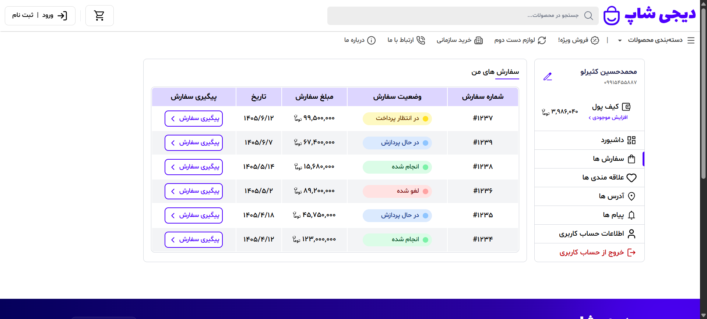 |

| Notifications | Uset information |
| --- | --- |
| 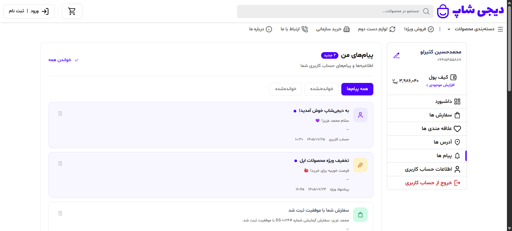 | 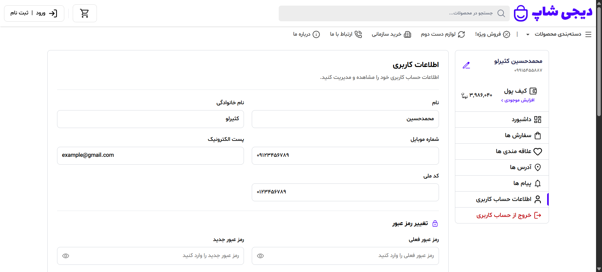 |

| Shipping | Payment |
| --- | --- |
| 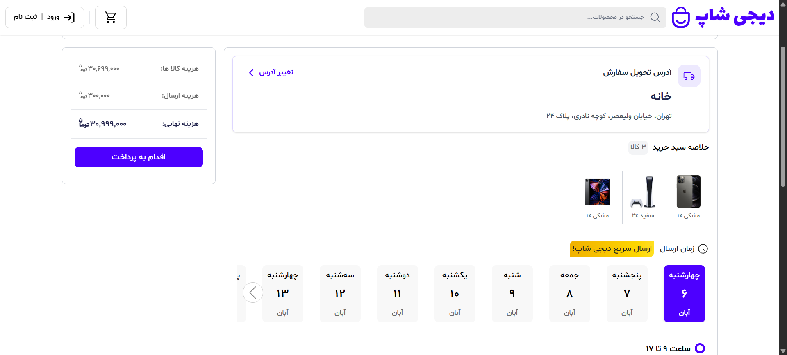 | 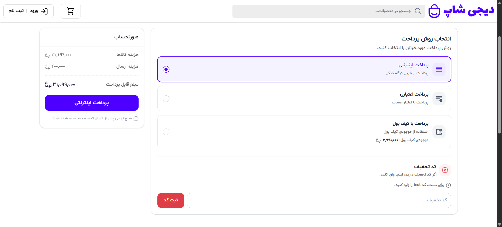 |

## ⚙️ Getting Started

### Prerequisites

Make sure you have [Node.js](https://nodejs.org/) and npm installed.

### Installation

1. Clone the repository:

   ```bash
   git clone https://github.com/MKasirloo/DigiShop.git
   ```

2. Navigate to the project directory:

   ```bash
   cd DigiShop
   ```

3. Install dependencies:

   ```bash
   npm install
   ```

4. Start the development server:

   ```bash
   npm run dev
   ```

5. Open the local URL displayed in your terminal.

### Production Build

```bash
npm run build
```

To preview the production build locally:

```bash
npm run preview
```

## 📁 Project Structure

```text
DigiShop/
├── public/
│   └── images/
├── src/
│   ├── assets/
│   ├── components/
│   ├── pages/
│   ├── App.jsx
│   └── main.jsx
├── index.html
├── package.json
└── README.md
```

*The structure above is illustrative and may differ from the current project.*

## 🎯 Project Goals

- Build a practical e-commerce interface using React
- Improve component-based development skills
- Create a responsive and accessible user experience
- Practice frontend architecture and state management
- Explore modern web development workflows


## 👨‍💻 Author

**MKasirloo**

GitHub: [@MKasirloo](https://github.com/MKasirloo)

---

<p align="center">
  Made with ❤️ and React
</p>
